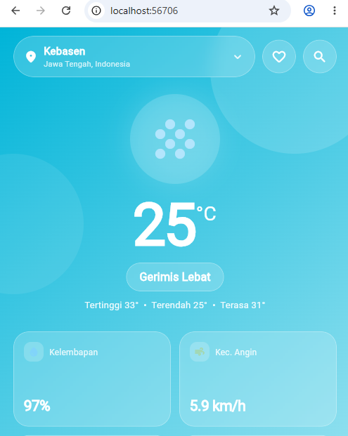
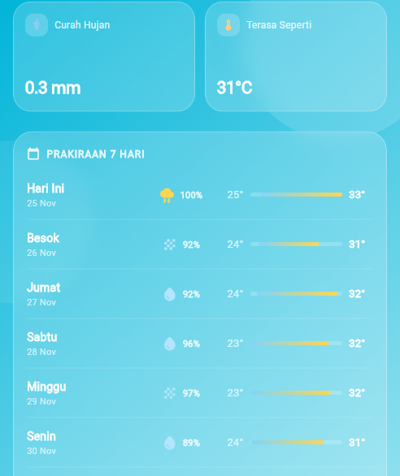
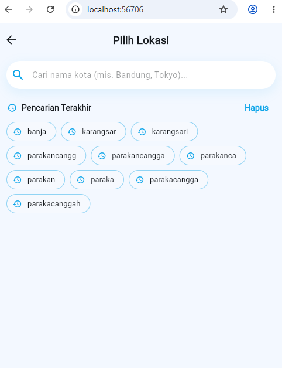
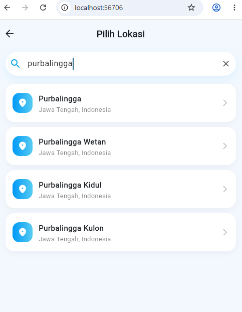

# Aplikasi Prakiraan Cuaca (Responsi Pemrograman Mobile 2)

- **Nama:** Yosi Rahmawati
- **NIM:** H1D024019
- **SHIFT KRS:** C
- **SHIFT BARU:** G
- **Video Demo (YouTube):** https://youtu.be/axloC2sdvRg

---

## Deskripsi Singkat

Aplikasi prakiraan cuaca berbasis Flutter yang menggunakan arsitektur Model-View-ViewModel (MVVM) dan mengambil data cuaca secara langsung dari Open-Meteo Weather Forecast API serta Open-Meteo Geocoding API.

## Screenshot Aplikasi

### 1. Tampilan 1


### 2. Tampilan 2


### 3. Tampilan 3


### 4. Tampilan 4


---

## Cara Menjalankan Kode

1. Pastikan Flutter SDK sudah terpasang dan dapat dijalankan melalui terminal atau IDE (Android Studio / VS Code).
2. Pastikan perangkat Android atau emulator sudah terhubung, serta koneksi internet aktif untuk mengambil data dari Open-Meteo API.
3. Buka terminal di direktori root proyek, lalu unduh seluruh dependensi dengan perintah:
   ```bash
   flutter pub get
   ```
4. Jalankan aplikasi dengan perintah:
   ```bash
   flutter run
   ```
   Atau tekan tombol Run pada Android Studio / VS Code setelah memilih target perangkat.
